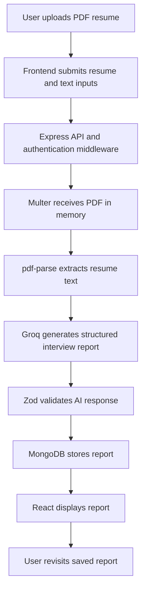
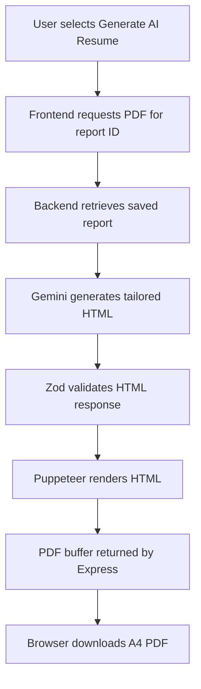

# Parsify — AI-Powered Resume Analyzer & Interview Prep

Parsify is a full-stack MERN application designed to help job seekers prepare for interviews. By analyzing a user's resume, their self-description, and a target job description, Parsify generates a structured, AI-powered interview preparation report tailored to the specific role.

## Features

- **Comprehensive Interview Report Generation**
  - **Match Score:** Calculates how well your resume aligns with the job description.
  - **Custom Questions:** Generates technical and behavioral questions based on your profile and the target role.
  - **Model Answers & Intentions:** Provides the reasoning behind each question and a suggested model answer.
  - **Skill-Gap Analysis:** Identifies missing skills and assigns severity levels (e.g., Low, Medium, High).
  - **Preparation Plan:** Creates a day-wise, actionable roadmap to help you prepare before the interview.
- **Report Management & Rehydration**
  - Securely store, retrieve, and view past reports. Rehydration logic ensures complex AI-generated structures are reliably reconstructed on the frontend.
- **PDF Export**
  - Converts the AI-generated React dashboard reports into clean, downloadable, and formatted PDF documents using Puppeteer.
- **Secure User Authentication**
  - Custom middleware-based authentication system utilizing dedicated `User` and `Session` models to protect API routes and user data.
- **Structured AI Output (Zod)**
  - Ensures the AI provider always returns perfectly formatted data by enforcing strict Zod schemas.
- **Multi-Provider AI Integration**
  - Seamlessly switch between or combine the power of Groq (Llama models) and Google Gemini for ultra-fast, high-quality report generation.

## Technology Stack

| Layer | Technologies |
|---|---|
| Frontend | React , Vite, React Router |
| UI and styling | Tailwind CSS, GSAP |
| State management | React Context API, custom hooks |
| HTTP communication | Axios |
| Backend | Node.js, Express  |
| Database | MongoDB, Mongoose |
| AI — interview report | Groq SDK |
| AI — tailored resume | Google Gemini API (`@google/genai`) |
| Output validation | Zod |
| Resume parsing | Multer, `pdf-parse` |
| PDF generation | Puppeteer |
| Authentication | JSON Web Tokens, cookie-parser, Node.js crypto |

## Application Workflow

### 1. Interview report generation



### 2. Tailored resume PDF generation


## Project Structure

```text
Backend/
└── src/
    ├── controllers/
    │   ├── auth.controller.js
    │   └── UPFE_Data.controller.js
    ├── middlewares/
    │   ├── auth.middleware.js
    │   └── file.middleware.js
    ├── models/
    │   ├── finalReportModel.js
    │   ├── sessionModel.js
    │   └── userModel.js
    ├── routes/
    │   ├── auth.route.js
    │   └── UPFE_Data.route.js
    ├── services/
    │   ├── ai.service.js
    │   └── aiServiceGemini.js
    └── app.js

Frontend/
└── src/
    ├── auth/
    │   ├── components/
    │   ├── context/
    │   ├── hooks/
    │   ├── pages/
    │   └── services/
    ├── ui/
    │   ├── components/
    │   ├── context/
    │   │   └── UPFE_Data.context.jsx
    │   ├── hooks/
    │   │   └── useUPFE_Data.js
    │   ├── pages/
    │   │   ├── feature.jsx
    │   │   ├── home.jsx
    │   │   ├── report.jsx
    │   └── services/
    │       └── UPFE_Data.api.js
    ├── App.jsx
    └── app.routes.jsx
```

## ⚙️ How It Works

1. **Input:** The user submits their resume (text/PDF), a brief self-description, and the target job description via the frontend.
2. **AI Processing:** The backend routes the data to the selected AI service (Groq or Gemini). The AI analyzes the data based on a strict prompt.
3. **Validation:** The AI's output is validated against a pre-defined Zod schema to ensure all arrays, objects, and strings (like the day-wise plan and skill gaps) are correctly formatted.
4. **Storage:** The validated report is saved to MongoDB, linked to the user's authenticated session.
5. **Display & Export:** The user views the visually formatted report on the React frontend. If they click "Download", Puppeteer spins up on the backend/frontend to render the view into a clean PDF.

## PDF Generation with Puppeteer

The resume-generation service follows this sequence:

1. Gemini returns a JSON object containing an HTML string.
2. Zod validates the response.
3. Puppeteer launches a headless Chromium browser.
4. The service loads the HTML using `page.setContent()`.
5. Puppeteer renders the page as an A4 PDF.
6. The backend sends the PDF buffer with an attachment filename.
7. The frontend receives the binary response and triggers the browser download.

The generated resume prompt requests a single-column, ATS-readable structure, inline CSS, web-safe fonts, and no invented candidate credentials.

Puppeteer requires a compatible browser binary. Its configuration places the browser cache under `Backend/.cache/puppeteer`. Ensure the deployment environment permits Chromium to launch and has the required system libraries. The launch arguments in the project include `--no-sandbox` and `--disable-dev-shm-usage`; review the security implications of running without the Chromium sandbox before deploying to a production environment.


## 💻 Local Setup & Installation

### Prerequisites
- Node.js (v18+ recommended)
- MongoDB (Local instance or MongoDB Atlas URL)
- Groq API Key
- Google Gemini API Key

### 1. Clone the repository
```bash
git clone https://github.com/yourusername/parsify.git
cd parsify
```

### 2. Environment Variables
Create a `.env` file in the `Backend/` directory and add the following:
```env
PORT=5000
MONGODB_URI=your_mongodb_connection_string
SESSION_SECRET=your_super_secret_session_key
GROQ_API_KEY=your_groq_api_key
GEMINI_API_KEY=your_gemini_api_key
```

### 3. Install Dependencies
**Backend:**
```bash
cd Backend
npm install
```

**Frontend:**
```bash
cd ../Frontend
npm install
```
## API Routes

All routes are mounted by the Express application as shown below.

### Authentication — `/api/auth`

| Method | Endpoint | Purpose | Authentication |
|---|---|---|---|
| POST | `/register` | Register a user | No |
| POST | `/login` | Log in a user | No |
| GET | `/refresh-token` | Refresh the access token using the refresh-token cookie | Cookie |
| GET | `/get-user` | Retrieve the authenticated user's details | Yes |
| GET | `/logout` | Log out / revoke the session | Cookie/session |

### Resume reports — `/api`

| Method | Endpoint | Purpose | Authentication |
|---|---|---|---|
| POST | `/upload` | Upload a resume and generate an interview report | Yes |
| GET | `/fetch` | Retrieve the authenticated user's report list | Yes |
| GET | `/fetch/:reportId` | Retrieve a specific report | Yes |
| POST | `/resume/pdf/:reportId` | Generate and download the tailored resume PDF | Yes |

The upload endpoint expects `multipart/form-data` with these fields:

- `resume` — PDF file (maximum 3 MB).
- `selfDescription` — candidate's description of their skills and experience.
- `jobDescription` — target role's job description.

Protected endpoints expect an access token in the `Authorization: Bearer <token>` header. Authentication also uses an HTTP-only refresh-token cookie.

### 4. Run the Application
Start both development servers. 

**Backend:**
```bash
cd Backend
npm run dev
```

**Frontend:**
```bash
cd Frontend
npm run dev
```

## 📝 License
This project is licensed under the MIT License.

**Parsify — Understand your fit. Prepare with direction. Present your best resume.**
